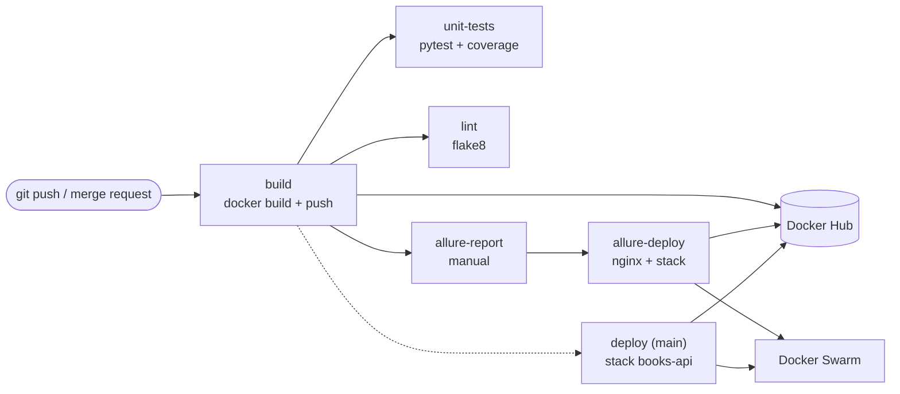

# Books API — FastAPI + GitLab CI/CD


REST API для управления коллекцией книг на **FastAPI**, для которого собран полный CI/CD-цикл: сборка Docker-образа, тесты и линт, публикация в **Docker Hub** и деплой в **Docker Swarm** через **GitLab CI**.

> Проект учебный: бизнес-логика намеренно простая, а основной акцент сделан на инфраструктуре, автоматизации и работе с секретами. Сервисная часть описана [ниже](#локальный-запуск).

## Содержание

- [О проекте](#о-проекте)
- [CI/CD пайплайн](#cicd-пайплайн)
- [Переменные CI/CD](#переменные-cicd)
- [Docker Hub](#docker-hub)
- [Деплой в Docker Swarm](#деплой-в-docker-swarm)
- [Как воспроизвести пайплайн](#как-воспроизвести-пайплайн)
- [Локальный запуск](#локальный-запуск)
- [API](#api)
- [Тесты](#тесты)
- [Структура проекта](#структура-проекта)
- [Ограничения и планы](#ограничения-и-планы)

## О проекте

Сервис хранит книги в памяти процесса и не переживает рестарт — для демонстрации пайплайна этого достаточно. Инфраструктурная часть проекта:

- сборка Docker-образа и публикация в Docker Hub с неизменяемым тегом по SHA коммита;
- прогон unit-тестов и линтера **внутри собранного образа**, а не в отдельном окружении;
- генерация Allure-отчёта и его публикация отдельным контейнером;
- деплой в Docker Swarm через `docker stack deploy`;
- работа с секретами через переменные GitLab CI и штатный механизм `DOCKER_AUTH_CONFIG`.

### Стек

- **Python 3.13**, FastAPI 0.141, Pydantic v2, Uvicorn
- **pytest** + **pytest-cov** + **allure-pytest**
- **flake8** — линтер в пайплайне
- **Docker 28**, Docker Swarm, GitLab CI

## CI/CD пайплайн

Пайплайн описан в [`.gitlab-ci.yml`](.gitlab-ci.yml) и состоит из трёх стадий: **`build` → `test` → `deploy`**. До деплоя доезжает только ветка `main`.



### Стадии и джобы

| Стадия | Джоба | Образ | Что делает | Запуск |
|--------|-------|-------|------------|--------|
| `build` | `build` | `docker:28` + `docker:28-dind` | Собирает образ и пушит тег `books-api-$CI_COMMIT_SHORT_SHA` | каждый пайплайн |
| `test` | `unit-tests` | собранный образ | `pytest tests/unit --cov=src`, coverage и JUnit-отчёт | каждый пайплайн |
| `test` | `lint` | собранный образ | `flake8 --show-source --statistics src/` | каждый пайплайн |
| `test` | `allure-report` | собранный образ | `pytest tests/allure`, `allure generate`, артефакт на 1 день | вручную |
| `deploy` | `allure-deploy` | `docker:28` + dind | nginx-образ с отчётом → push → stack `allure-report-<ref>` | после `allure-report` |
| `deploy` | `deploy` | `docker:28` | `docker stack deploy` стека `books-api` | только `main` |

Ключевые решения:

- **Иммутабельные теги.** Образ тегируется коротким SHA коммита, `latest` не используется. Откат сводится к деплою предыдущего тега.
- **Тесты в том же образе.** `unit-tests`, `lint` и `allure-report` запускаются с `image: $DOCKER_IMAGE_TAG`, то есть проверяется ровно тот артефакт, который поедет на сервер. Побочный эффект — этим джобам нужна авторизация для `pull` из Docker Hub (см. [`DOCKER_AUTH_CONFIG`](#docker_auth_config)).
- **Coverage в merge request.** GitLab парсит вывод `pytest-cov` регуляркой из `coverage:` и показывает процент покрытия прямо в MR.
- **Allure как отдельный сервис.** `allure-report` генерирует HTML, `allure-deploy` упаковывает его в nginx-образ и раскатывает отдельным стеком. Контекст сборки ограничен каталогом `allure-report` через `ci/allure/Dockerfile.dockerignore`.
- **`--with-registry-auth`.** Креды Docker Hub передаются узлам Swarm при деплое, поэтому на worker-нодах не нужен отдельный `docker login`.

### Требования к раннеру

- Docker executor с `privileged = true` — обязательное условие для docker-in-docker (`docker:28-dind`, `DOCKER_HOST: docker:2375`, `DOCKER_TLS_CERTDIR: ""`).
- Сетевой доступ к Docker Hub (для push и для pull базовых образов) и к manager-ноде Swarm.
- В образе приложения уже установлены JDK и Allure CLI (см. `Dockerfile`), поэтому джоба отчёта не тратит время на их установку.
- Для сборки используется BuildKit (по умолчанию в Docker 28): cache-mount для pip и `Dockerfile.dockerignore` для контекста отчёта.

## Переменные CI/CD

Все значения задаются в GitLab: **Settings → CI/CD → Variables**. В репозиторий они не коммитятся.

| Переменная | Пример | Назначение | Настройки |
|------------|--------|------------|-----------|
| `DOCKER_REGISTRY` | `docker.io` | Хост registry, подставляется в имя образа | — |
| `DOCKER_REPOSITORY` | `username/books-api` | Репозиторий внутри registry | — |
| `DOCKER_REGISTRY_USER` | `username` | Логин для `docker login` | — |
| `DOCKER_REGISTRY_PASSWORD` | `dckr_pat_***` | Пароль или Personal Access Token | **Masked** |
| `DOCKER_AUTH_CONFIG` | JSON (см. ниже) | Авторизация раннера для `pull` образа | **Masked** |
| `DEPLOY_SERVER_ADDR` | `tcp://10.0.0.5:2376` | Адрес manager-ноды Docker Swarm | **Protected** |

Служебные переменные — вычисляются в пайплайне или предоставляются GitLab:

| Переменная | Значение |
|------------|----------|
| `DOCKER_IMAGE_TAG` | `$DOCKER_REGISTRY/$DOCKER_REPOSITORY:books-api-$CI_COMMIT_SHORT_SHA` |
| `ALLURE_IMAGE_TAG` | `$DOCKER_REGISTRY/$DOCKER_REPOSITORY:allure-report-$CI_COMMIT_SHORT_SHA` |
| `CI_COMMIT_SHORT_SHA` | первые 8 символов SHA коммита (predefined) |

> **Важно:** `DOCKER_REGISTRY` — это только хост без схемы (`docker.io`, а не `https://docker.io`), потому что он подставляется в имя образа. URL `https://index.docker.io/v1/` используется только как ключ внутри `DOCKER_AUTH_CONFIG`.

`DOCKER_AUTH_CONFIG` нужна всем джобам, включая пайплайны merge request, поэтому её **не стоит** помечать как Protected. `DEPLOY_SERVER_ADDR` наоборот имеет смысл защищать, но только если ветка `main` объявлена protected — иначе переменная не попадёт в джобу деплоя.

### DOCKER_AUTH_CONFIG

**Зачем.** Джобы `unit-tests`, `lint` и `allure-report` используют `image: $DOCKER_IMAGE_TAG`. Образ тянет сам GitLab Runner, до запуска `before_script`, поэтому `docker login` из джобы тут не помогает. Если репозиторий в Docker Hub приватный, без `DOCKER_AUTH_CONFIG` раннер получит `unauthorized`.

`DOCKER_AUTH_CONFIG` — штатный механизм GitLab: раннер подставляет значение в `~/.docker/config.json` при выполнении джобы.

Формат — тот же, что у `~/.docker/config.json`:

```json
{
  "auths": {
    "https://index.docker.io/v1/": {
      "auth": "<base64 от username:token>"
    }
  }
}
```

Поле `auth` — это Base64-строка вида `username:token`. Получить её:

```bash
echo -n "<username>:<token>" | base64
```

В PowerShell (Windows):

```powershell
[Convert]::ToBase64String([Text.Encoding]::UTF8.GetBytes("<username>:<token>"))
```

Где взять `<token>`: Docker Hub → **Account Settings → Security → New Access Token**, права **Read & Write**. Пароль от аккаунта использовать не нужно, особенно если включена двухфакторная аутентификация.

Итоговое значение переменной — компактный JSON одной строкой с уже подставленным `auth`. Включите **Masked**, чтобы значение не попадало в логи.

Отдельно обратите внимание: `docker login` в `before_script` нужен для **push** из джобы, а `DOCKER_AUTH_CONFIG` — для **pull** образа самим раннером. Это два разных механизма, и в пайплайне используются оба.

### DEPLOY_SERVER_ADDR

Деплой выполняется командой `docker -H $DEPLOY_SERVER_ADDR stack deploy ...`, то есть Docker CLI подключается к API manager-ноды. Варианты адреса:

- `ssh://deploy@10.0.0.5` — подключение по SSH-ключу. Безопаснее открытого TCP, но ключ нужно добавить в джобу (например, через SSH agent).
- `tcp://10.0.0.5:2376` — Docker API с TLS; клиентские сертификаты должны быть доступны в джобе.
- `tcp://10.0.0.5:2375` — без TLS, допустимо только в изолированной лабораторной сети.

Порт должен быть доступен с раннера, а пользователь — иметь права на операции Swarm (фактически это root-доступ к Docker-хосту).

## Docker Hub

**Docker Hub использовался для хранения репозиториев билдов** — все собранные образы лежат там, отдельный self-hosted registry не разворачивался.

| Образ | Кто создаёт | Назначение |
|-------|-------------|------------|
| `<registry>/<repository>:books-api-<sha>` | `build` | приложение |
| `<registry>/<repository>:allure-report-<sha>` | `allure-deploy` | nginx с Allure-отчётом |
| `python:3.13-slim-bookworm` | Docker Hub | базовый образ приложения |
| `nginx:1.31.6` | Docker Hub | базовый образ отчёта |

Почему Docker Hub:

- нативные `docker login` / `push` / `pull`, ничего дополнительно настраивать не нужно;
- `docker stack deploy --with-registry-auth` передаёт креды узлам Swarm, и они сами тянут приватный образ;
- бесплатные публичные репозитории и понятная веб-панель для проверки тегов.

Репозиторий может быть приватным — в этом случае авторизация нужна и на push, и на pull (см. переменные выше). Старые теги в Docker Hub не удаляются автоматически: для долгоживущего проекта стоит настроить cleanup policy или добавить в пайплайн шаг очистки.

## Деплой в Docker Swarm

Стек приложения — [`docker-swarm/stacks/api.yaml`](docker-swarm/stacks/api.yaml):

```yaml
services:
  api:
    image: $DOCKER_IMAGE_TAG
    ports:
      - "8000:8000"
```

`docker stack deploy` подставляет переменные окружения CLI в compose-файл, поэтому `$DOCKER_IMAGE_TAG` раскрывается в полный тег в момент деплоя. Имя стека — `books-api`.

Отчёт раскатывается аналогично, из [`docker-swarm/stacks/allure-report.yaml`](docker-swarm/stacks/allure-report.yaml), в стек с именем `allure-report-$CI_COMMIT_REF_SLUG` и публикацией на порт `8080`.

Ручной деплой без CI:

```bash
export DOCKER_IMAGE_TAG=docker.io/<username>/books-api:books-api-<sha>
docker -H ssh://deploy@10.0.0.5 stack deploy \
  --with-registry-auth \
  -c docker-swarm/stacks/api.yaml \
  books-api
```

## Как воспроизвести пайплайн

1. Склонировать репозиторий и создать проект в GitLab.
2. В Docker Hub создать репозиторий, например `username/books-api` (можно приватный).
3. Выпустить Personal Access Token с правами **Read & Write**.
4. Заполнить в GitLab шесть переменных из [таблицы](#переменные-cicd): `DOCKER_REGISTRY`, `DOCKER_REPOSITORY`, `DOCKER_REGISTRY_USER`, `DOCKER_REGISTRY_PASSWORD`, `DOCKER_AUTH_CONFIG`, `DEPLOY_SERVER_ADDR`.
5. Подготовить раннер с Docker executor и `privileged = true`.
6. Подготовить Swarm: `docker swarm init` на manager-ноде, открыть доступ к API (2376/2375 — только с раннера) и портам `8000` и `8080`.
7. Сделать push в `main` — пайплайн соберёт образ, прогонит тесты и задеплоит стек.
8. Для Allure-отчёта вручную запустить `allure-report`, затем дождаться `allure-deploy`.

## Локальный запуск

### Локально

```bash
python3 -m venv .venv
source .venv/bin/activate
pip install -r requirements.txt
uvicorn src.main:app --host 0.0.0.0 --port 8000 --reload
```

Windows (PowerShell):

```powershell
python -m venv .venv
.venv\Scripts\Activate.ps1
pip install -r requirements.txt
uvicorn src.main:app --host 0.0.0.0 --port 8000 --reload
```

API будет доступно на `http://localhost:8000`, интерактивная документация — на `http://localhost:8000/docs`.

### Docker

```bash
docker build -t books-api .
docker run -p 8000:8000 books-api
```

## API

| Метод | Путь | Описание |
|-------|------|----------|
| `GET` | `/` | Статус сервиса |
| `POST` | `/books/` | Создать книгу |
| `GET` | `/books/` | Список всех книг |
| `GET` | `/books/{id}` | Получить книгу по ID |
| `PUT` | `/books/{id}` | Обновить книгу |
| `DELETE` | `/books/{id}` | Удалить книгу |

**Создать книгу**

```bash
curl -X POST http://localhost:8000/books/ \
  -H "Content-Type: application/json" \
  -d '{"title": "Clean Code", "author": "Robert Martin", "description": "A handbook of agile software craftsmanship"}'
```

**Получить все книги**

```bash
curl http://localhost:8000/books/
```

**Обновить книгу**

```bash
curl -X PUT http://localhost:8000/books/1 \
  -H "Content-Type: application/json" \
  -d '{"title": "Clean Code (2nd Edition)"}'
```

**Удалить книгу**

```bash
curl -X DELETE http://localhost:8000/books/1
```

## Тесты

В проекте два набора: обычные unit-тесты и тесты с Allure-шагами.

```bash
pytest                                 # все тесты
pytest --cov=src                       # с покрытием
pytest --alluredir=allure-results      # с результатами Allure
allure serve allure-results            # локальный просмотр отчёта
```

В CI это те же команды, но выполняются внутри собранного образа: `pytest -vv tests/unit --cov=src` для `unit-tests` и `pytest -vv --alluredir=allure-results tests/allure` для `allure-report`.

## Структура проекта

```text
.
├── .gitlab-ci.yml                 # Пайплайн: build → test → deploy
├── Dockerfile                     # Образ приложения (Python + JDK + Allure CLI)
├── .dockerignore
├── docker-swarm/
│   └── stacks/
│       ├── api.yaml               # Стек сервиса
│       └── allure-report.yaml     # Стек с Allure-отчётом
├── ci/
│   └── allure/
│       ├── Dockerfile              # nginx-образ для публикации отчёта
│       └── Dockerfile.dockerignore # Ограничивает контекст сборки отчёта
├── src/
│   ├── main.py                    # Точка входа, инициализация приложения
│   ├── models.py                  # Модель данных и in-memory хранилище
│   ├── schemas.py                 # Схемы запросов и ответов
│   ├── crud.py                    # Операции с данными
│   └── routers/
│       └── books.py               # Роуты /books
├── tests/
│   ├── unit/                      # Unit-тесты
│   └── allure/                    # Тесты с Allure-шагами
├── pyproject.toml                 # Конфигурация pytest
└── requirements.txt
```

## Ограничения и планы

- Нет разделения на staging и production: `deploy` идёт сразу на единственный Swarm-кластер.
- В стеке не заданы `healthcheck`, `update_config`, `rollback_config` и количество реплик — обновления идут без контроля состояния сервиса.
- Джобы Allure запускаются вручную и не являются обязательным quality gate.
- Нет автоматической очистки старых тегов в Docker Hub и registry-кэша BuildKit — сборки со временем замедляются.
- Секреты хранятся в переменных GitLab CI; следующий шаг — Vault или SOPS.
- Деплой идёт по TCP/SSH напрямую к manager-ноде; в продакшене лучше bastion или VPN.
- `Dockerfile` одностадийный: в образ попадают JDK, Allure CLI и тесты — он тяжелее, чем нужно для рантайма; логичный шаг — multi-stage build.
- Данные хранятся в памяти процесса: после рестарта контейнера коллекция книг пустая.
